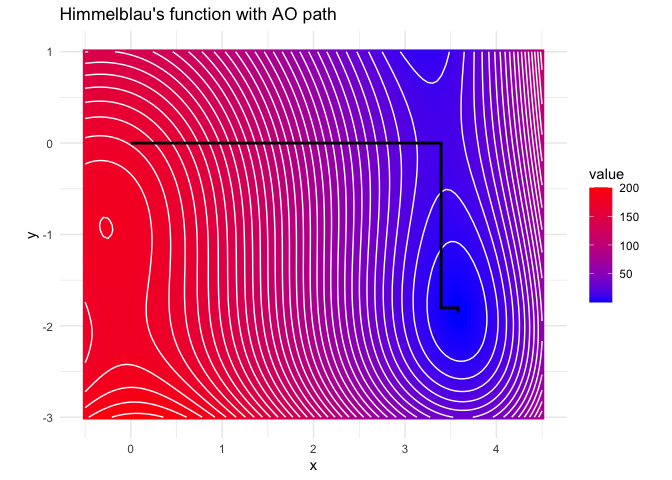

<!-- README.md is generated from README.Rmd. Please edit that file -->

# Alternating optimization 

<!-- badges: start -->

[](https://CRAN.R-project.org/package=ao)
[](https://CRAN.R-project.org/package=ao)
[](https://cran.r-project.org/package=ao)
[](https://github.com/loelschlaeger/ao/actions)
[](https://github.com/loelschlaeger/ao/actions)
[](https://app.codecov.io/gh/loelschlaeger/ao?branch=main)
[](https://lifecycle.r-lib.org/articles/stages.html#stable)
<!-- badges: end -->

The `{ao}` package implements alternating optimization (AO) in
[R](https://cran.r-project.org/).

## Why?

AO is an iterative process that optimizes a function by alternately
performing restricted optimization over parameter subsets. Instead of
solving one joint optimization problem, AO breaks it into smaller
sub-problems. This can make optimization feasible when joint
optimization is too difficult.

The AO process implemented in `{ao}` can be

- viewed as a generalization of joint optimization,

- used for minimization and maximization problems with custom parameter
  partitions,

- randomized by changing the parameter partition randomly after each
  iteration,

- run in multiple processes for different initial values, parameter
  partitions, and/or base optimizers (which run in parallel if the
  `{future.apply}` package is installed and a parallel plan is set).

See the [package vignette](https://loelschlaeger.de/ao/articles/ao.html)
for more details.

## How?

You can install the released package version from
[CRAN](https://CRAN.R-project.org) with:

``` r
install.packages("ao")
```

Then load the package with `library("ao")`. Here is a simple example of
alternating minimization of [Himmelblau’s
function](https://en.wikipedia.org/wiki/Himmelblau%27s_function):

``` r
himmelblau <- function(x) (x[1]^2 + x[2] - 11)^2 + (x[1] + x[2]^2 - 7)^2
```

The resulting optimization path is shown below.

<!-- -->

It is obtained with:

``` r
ao(f = himmelblau, initial = c(0, 0))
#> $estimate
#> [1]  3.584427 -1.848124
#> 
#> $value
#> [1] 9.15386e-11
#> 
#> $details
#>   iteration        value       p1        p2 b1 b2     seconds
#> 1         0 1.700000e+02 0.000000  0.000000  0  0 0.000000000
#> 2         1 1.327270e+01 3.395691  0.000000  1  0 0.005705118
#> 3         1 1.743664e+00 3.395691 -1.803183  0  1 0.002934933
#> 4         2 2.847290e-02 3.581412 -1.803183  1  0 0.002274990
#> 5         2 4.687468e-04 3.581412 -1.847412  0  1 0.001963139
#> 6         3 7.368057e-06 3.584381 -1.847412  1  0 0.001662970
#> 7         3 1.164202e-07 3.584381 -1.848115  0  1 0.017327070
#> 8         4 1.893311e-09 3.584427 -1.848115  1  0 0.001352072
#> 9         4 9.153860e-11 3.584427 -1.848124  0  1 0.001142979
#> 
#> $seconds
#> [1] 0.03436327
#> 
#> $stopping_reason
#> [1] "change in function value between 1 iteration is < 1e-06"
```

## Contact?

If you have questions, find a bug, or need a feature, [file an issue on
GitHub](https://github.com/loelschlaeger/ao/issues/new/choose).
